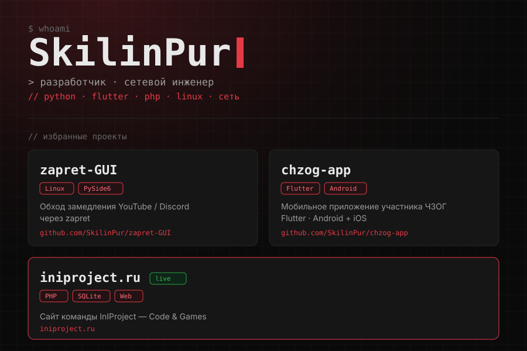

<p align="center">
  
</p>

<p align="center">
  <samp>Arch Linux · Hyprland · self-hosted</samp>
</p>

---

## // stack

<p align="center">
  
</p>

<p align="center">
  
</p>

<p align="center">
  
</p>

---

## // projects

```text
$ ls ~/projects
zapret-GUI           GUI для zapret на Linux (YouTube / Discord)          [public]
zapret-GUI-Windows   то же для Windows, обёртка над winws                 [public]
greenboard           панель управления видеокартой для Linux              [public]
chzog-app            мобильное приложение участника ЧЗОГ                  [public]
ininet-win           сетевой сканер и монитор соединений (Windows)         [public]
iniproject.ru        сайт команды InIProject — Code & Games               [live]
```

**Открытое:**
- [zapret-GUI](https://github.com/SkilinPur/zapret-GUI) — Linux, PySide6
- [zapret-GUI-Windows](https://github.com/SkilinPur/zapret-GUI-Windows) — Windows, PySide6 + WinDivert
- [greenboard](https://github.com/SkilinPur/greenboard) — Linux, PySide6
- [chzog-app](https://github.com/SkilinPur/chzog-app) — Flutter, Android / iOS
- [ininet-win](https://github.com/SkilinPur/ininet-win) — Windows, TUI/CLI
- [iniproject.ru](https://iniproject.ru) — PHP · SQLite · JS

**Ещё в работе:** API на FastAPI + PostgreSQL, Telegram-боты на aiogram, инфраструктура на VPS.

---

## // stats

<p align="center">
  
</p>

<p align="center">
  
</p>

<p align="center">
  
</p>

<p align="center">
  
</p>

---

<p align="center">
  <samp>
    <code>const goals = [] // todo: add sleep</code><br>
    <code>while (true) { code(); game(); }</code><br><br>
    <sub><code>&gt; echo "спасибо, что заглянул"</code></sub>
  </samp>
</p>
